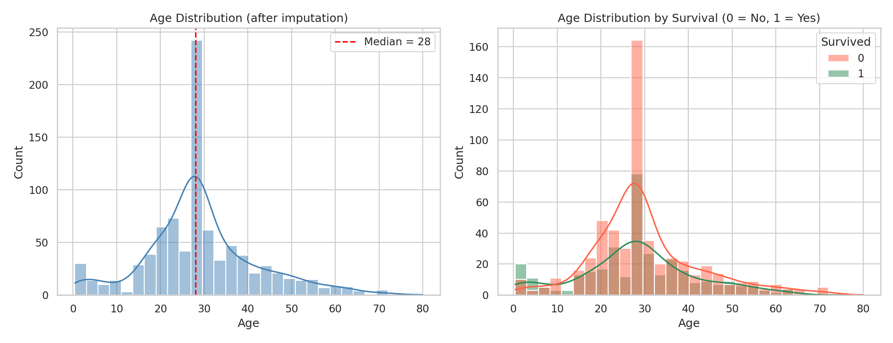

# Titanic Survival Prediction: Data Cleaning Project

A data cleaning and preprocessing project on the Titanic passenger dataset, built with Pandas, Scikit-learn, Matplotlib and Seaborn. It prepares the raw data for a survival prediction model.

## Dataset

[Titanic Dataset (Kaggle)](https://www.kaggle.com/c/titanic/data): 891 passengers, 12 columns (`train.csv`).

| Column | Description |
|---|---|
| PassengerId | Unique passenger ID |
| Survived | 0 = No, 1 = Yes |
| Pclass | Ticket class (1, 2, 3) |
| Name, Sex, Age | Passenger details |
| SibSp, Parch | Siblings/spouses and parents/children aboard |
| Ticket, Fare, Cabin | Ticket number, fare paid, cabin number |
| Embarked | Port of embarkation (C, Q, S) |

## Project Structure

```
├── titanic.csv             # Raw dataset
├── titanic_cleaning.py     # Complete cleaning script
├── titanic_cleaned.csv     # Cleaned output dataset
├── age_distribution.png    # Age distribution plots
└── README.md
```

## Tasks Completed

### 1. Load the data and summarize basic stats
- Loaded the CSV with `pd.read_csv()`.
- Used `.info()` to check data types and non-null counts.
- Used `.describe()` for numeric and categorical summaries.

### 2. Handle missing data

| Column | Missing | Method | Reason |
|---|---|---|---|
| Age | 177 | Median imputation (28.0) | Age is right-skewed, so the median is more robust than the mean |
| Embarked | 2 | Mode imputation (`S`) | Categorical column, so the most frequent value is used |
| Cabin | 687 (77%) | Dropped | Too sparse to impute reliably |

Result: 0 missing values remain.

### 3. Encode categorical variables
- **`Sex`** uses `LabelEncoder` (female = 0, male = 1), since it is binary.
- **`Embarked`** uses `OneHotEncoder`, giving `Embarked_C`, `Embarked_Q` and `Embarked_S`. The ports have no natural order, so one-hot avoids implying a ranking.

### 4. Visualize age distribution
Histograms with KDE curves of age, overall and split by survival (see `age_distribution.png`).



**Observations**
- Most passengers were aged 20 to 40.
- The spike at age 28 is an artifact of median imputation, not a real feature of the data.
- Children under about 10 had a noticeably higher survival rate.

### 5. Export the cleaned dataset
Saved as `titanic_cleaned.csv` (891 rows, 15 columns), including the new `Sex_encoded` and `Embarked_*` columns.

## How to Run

1. Install the requirements:
   ```bash
   pip install pandas numpy scikit-learn matplotlib seaborn
   ```
2. Place `titanic.csv` in the same folder as the script.
3. Run:
   ```bash
   python titanic_cleaning.py
   ```

This prints the summaries, saves `age_distribution.png` and writes `titanic_cleaned.csv`.

## Tech Stack
Python, Pandas, NumPy, Scikit-learn, Matplotlib, Seaborn

## Author
**Ayush**, B.Tech Computer Science (AI & ML)
